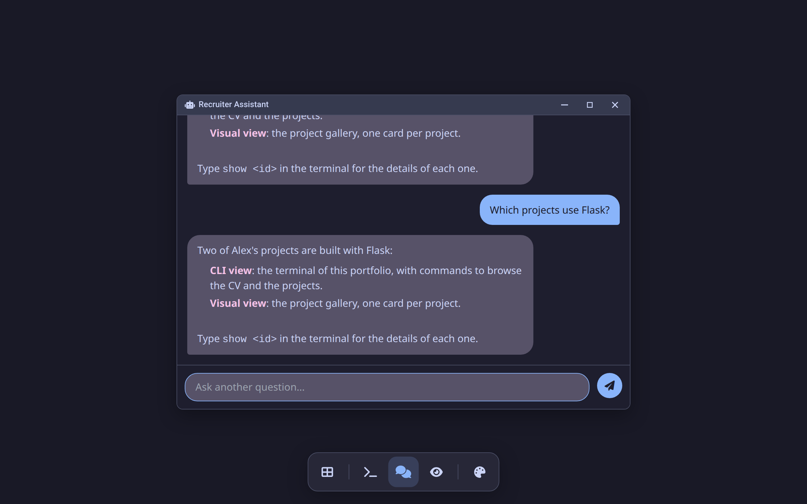
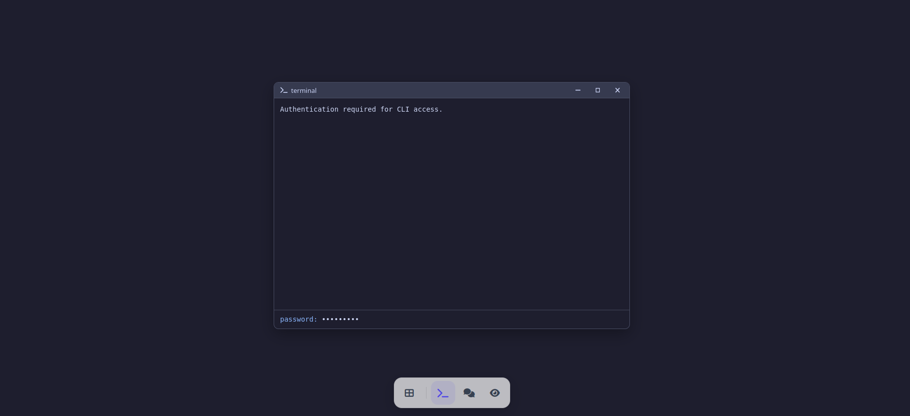

# Unified Portfolio

<!-- Badges -->
[](LICENSE)
[](https://www.python.org)
[](https://flask.palletsprojects.com/)
[](https://github.com/psf/black)
[](https://pycqa.github.io/isort/)
[](https://flake8.pycqa.org/)
[](https://github.com/PPeitsch/porfolio/actions/workflows/code-quality.yml)
[](https://github.com/PPeitsch/porfolio/actions/workflows/tests.yml)
[](https://codecov.io/gh/PPeitsch/porfolio)
[](.github/CONTRIBUTING.md)

A portfolio website with three ways in: a terminal for developers, an AI chat for recruiters and a visual gallery. Built with Python, Flask and vanilla JavaScript.

**Live demo:** [ppeitsch.com.ar](https://ppeitsch.com.ar), the author's own portfolio running this engine.

The engine and the content are separate: your CV, projects and texts live in plain YAML and text files, so you can use it for your own portfolio without touching the code.

---

## Screenshots

With the bundled example content (`data/`) and the `catppuccin` theme. `python scripts/screenshots.py --example-images` takes them again after a change to the views (it needs `pip install playwright && playwright install chromium`).

<table>
  <tr>
    <td width="50%" align="center">
      <p><strong>1. View Selector</strong></p>
      
    </td>
    <td width="50%" align="center">
      <p><strong>2. Developer (CLI) View</strong></p>
      
    </td>
  </tr>
  <tr>
    <td width="50%" align="center">
      <p><strong>3. Recruiter (AI Chat) View</strong></p>
      
    </td>
    <td width="50%" align="center">
      <p><strong>4. Visual Overview</strong></p>
      
    </td>
  </tr>
</table>

## Features

*   **Three views** of the same content:
    *   **Developer view:** a draggable, themeable terminal with commands such as `whoami`, `ls projects`, `filter --tech <name>`, `show <project>` and `neofetch`.
    *   **Recruiter view:** an AI chat that answers questions by reading your data through function calling, so it stays in sync with your files. It works with any provider LiteLLM supports: OpenRouter, Anthropic, OpenAI, Gemini, a local Ollama and more.
    *   **Visual view:** one card per project, with image, main technologies and links.
*   **Access code:** the terminal and the chat are protected by a code (JWT-based) to prevent abuse of your LLM API key.
*   **Content as files:** CV, projects, system prompt, UI texts, ASCII logos and project images, all in one folder you can keep outside the repository.
*   **Bilingual:** interface and content in English and Spanish (or any languages you configure), chosen from the browser's language or a switcher (see [Languages](#languages)).
*   **Any LLM provider:** one setting, `LLM_MODEL`, picks provider and model (see [Choosing the Model](#choosing-the-model)).
*   **Quality checks:** Black, isort, Flake8 and MyPy via pre-commit, Bandit and pip-audit in CI, and a test suite with coverage reported to Codecov.

### Authentication

Both the terminal and the chat ask for the access code before they can be used.

Some limits, per client IP, keep the chat and the code from abuse: after 5 wrong codes in 15 minutes (or 20 in a day) every attempt is refused for a while, the chat takes up to 8 messages a minute, 60 an hour and 200 a day, and a message can be up to 2000 characters. Past a limit the chat shows a notice saying how long to wait. `AUTH_FAILURE_LIMITS`, `CHAT_RATE_LIMITS` and `CHAT_MAX_MESSAGE_CHARS` change them (see `.env.example`). The counts are kept in each worker's memory, so with several workers a client gets up to that many times the limit; for hard limits use the proxy (Nginx `limit_req`, fail2ban).

<p align="center">
  
</p>

## Quick Start

1.  **Clone:** `git clone https://github.com/PPeitsch/porfolio.git && cd porfolio`
2.  **Create an environment:** `python -m venv venv && source venv/bin/activate`
3.  **Install dependencies:** `pip install -r requirements-dev.txt`
4.  **Configure:** copy `.env.example` to `.env` and set at least `SECRET_KEY`, `RECRUITER_ACCESS_CODE` `LLM_MODEL` and the API key of its provider.
5.  **Install the pre-commit hooks:** `pre-commit install`
6.  **Run:** `FLASK_DEBUG=1 python run.py` and open `http://127.0.0.1:5000`. `FLASK_DEBUG=1` turns on auto-reload and the debugger; the server listens on localhost unless `FLASK_RUN_HOST` sets another address. `run.py` is for development only: in production, run `run:app` with a WSGI server such as gunicorn.

It starts with the example content in `data/`. Replace it with yours as described below.

## Use It for Your Own Portfolio

All the content is read from one folder: `data/` by default, or the path in `PORTFOLIO_DATA_DIR` (relative paths are resolved from the project root). Pointing `PORTFOLIO_DATA_DIR` at a folder outside the repository lets you pull updates without conflicts in your content.

| File | What it holds |
|---|---|
| `cv.yaml` | `name`, `title`, `email`, `website`, `summary`, `skills`, `social_links` (`github`, `linkedin`, ...), `experience` (`role`, `company`, `period`, `description`) and `education` (`degree`, `institution`, `period`). |
| `projects.yaml` | A list of projects: `id`, `title`, `type`, `image`, `short_description`, `description`, `technologies` and optional `live_url`, `github_url`, `pypi_url`, `docs_url`. |
| `images/` | Project images, referenced by file name from the `image` field of each project. |
| `system_prompt.txt` | Optional. The system prompt of the AI chat, in place of the engine's `app/defaults/system_prompt.txt`, which keeps the chat to questions about the profile, in the third person and without emojis. `{name}` is replaced with the name in `cv.yaml`. |
| `text_config.yaml` | Optional. Overrides of the UI texts, which the engine brings in `app/defaults/text_config.yaml`: welcome messages of the terminal and the chat, the terminal prompt, help and manual pages of the terminal commands, the tool descriptions the AI chat receives, and the translations of the interface (`ui`). It is merged key by key over the engine's file, so it only needs what changes; the example in `data/` sets the terminal welcome, prompt and logo. |
| `logo/` | Optional. ASCII logos for the `neofetch` command, one per `neofetch_logo_<name>.txt`, added to the engine's ones in `app/defaults/logo/` (a logo with the same name replaces the engine's). `cli.neofetch.logo` in `text_config.yaml` picks the default one by name (`flask` if unset), `neofetch --logo <name>` shows another, and `neofetch --logo` alone shows the next one each time. |
| `pages/` | Optional standalone pages, such as a services page: `pages/services.html` is served at `/p/services`, and the files it links relatively are served next to it. |

## Languages

The site is offered in the languages of `PORTFOLIO_LANGUAGES` (default `en,es`). Each visitor gets the language chosen with the switcher (remembered in a cookie), or else the browser's preferred one, or else `PORTFOLIO_DEFAULT_LANGUAGE` (default: the first of the list). With a single language, the switcher is hidden.

Any text in the content files can be a plain string, shown in every language, or one translation per language:

```yaml
title:
  en: Python Developer
  es: Desarrollador Python
```

A text missing in the visitor's language falls back to the default language, then to any translation given. The example files in `data/` are bilingual.

The interface texts (buttons, placeholders, terminal messages) are built in in English; the `ui` section of the engine's `app/defaults/text_config.yaml` holds their Spanish translations, e.g. `ui.chat.thinking.es`. `UI_DEFAULTS` in `app/common/i18n.py` lists every key. To add a language, add its code to `PORTFOLIO_LANGUAGES` and its translations to the content files and, under `ui`, `cli.commands` and `cli.manuals`, to the `text_config.yaml` of the content.

The chat is told the visitor's language, and answers in the language of each question.


## Themes

The whole site follows one of five color themes: `dracula`, `light`, `solarized`, `gruvbox` and `catppuccin`. Visitors switch it with the palette button (or the CLI's `theme` command), and their choice is remembered in the browser. Those who have not picked one get `PORTFOLIO_DEFAULT_THEME` (default `catppuccin`).

## Choosing the Model

The chat goes through [LiteLLM](https://docs.litellm.ai/docs/providers), so `LLM_MODEL` is `<provider>/<model>` and the key goes in the provider's usual variable:

| `LLM_MODEL` | Key |
|---|---|
| `openrouter/anthropic/claude-haiku-4.5` | `OPENROUTER_API_KEY` |
| `anthropic/claude-haiku-4-5-20251001` | `ANTHROPIC_API_KEY` |
| `openai/gpt-4.1-mini` | `OPENAI_API_KEY` |
| `gemini/gemini-2.5-flash` | `GEMINI_API_KEY` |
| `ollama/llama3.1` | none; set `LLM_API_BASE=http://localhost:11434` |

The model must support tool (function) calling. `LLM_API_KEY` overrides the provider variable, `LLM_TIMEOUT` sets the seconds to wait for each response (default 30) and `LLM_MAX_TOOL_ROUNDS` caps the rounds of tool calls per question (default 5). `LLM_MAX_TOKENS` caps each response (default 1024; in reasoning models the reasoning counts too), `LLM_REASONING_EFFORT` sets the reasoning of models that reason (`none` turns it off where the model allows it), and `LLM_FALLBACK_MODELS` lists models tried in order when `LLM_MODEL` fails, each with an optional `@<effort>` (`LLM_REASONING_EFFORT` applies only to `LLM_MODEL`, since some models cannot turn reasoning off). `LLM_MAX_PRICE` caps the price of each request to OpenRouter models, as `<input>/<output>` in USD per million tokens (e.g. `0.5/2`): if the model gets dearer than that, the request fails and the next fallback answers.

Every call to the model leaves a line in `instance/llm_usage/llm_usage_<date>.jsonl`: the model that answered, tokens, cost in USD (what OpenRouter charged, or LiteLLM's estimate), latency, tool calls, the kind of error and the visitor as a hash of the IP with `SECRET_KEY`. Never the conversation. `LLM_USAGE_DIR` moves it (empty turns it off) and `LLM_USAGE_KEEP_DAYS` sets how many days are kept (default 90). `python scripts/llm_usage_report.py` sums it by day, with the most calls from a single visitor, which is the first number to look at for abuse.

Older configurations with `LLM_PROVIDER` and `ANTHROPIC_MODEL`/`OPENAI_MODEL`/`GEMINI_MODEL` still work when `LLM_MODEL` is not set. `GEMINI_PROXY_URL` is no longer supported.

## Dependency Management

Dependencies are managed with `pip-tools`:

-   **Production** dependencies are listed in `requirements.in`.
-   **Development** dependencies are listed in `requirements-dev.in`.

After changing an `.in` file, regenerate the locked files:

```bash
# Linux/macOS
./scripts/compile-reqs.sh

# Windows (PowerShell)
./scripts/compile-reqs.ps1
```

## Deployment

Run it with a production WSGI server such as Gunicorn or Waitress behind a reverse proxy such as Nginx.

```bash
# Production environment variables
export SECRET_KEY='your-strong-production-secret-key'
export RECRUITER_ACCESS_CODE='your-production-access-code'
export LLM_MODEL='openrouter/anthropic/claude-haiku-4.5'
export OPENROUTER_API_KEY='your-production-openrouter-key'
export PORTFOLIO_DATA_DIR='/srv/portfolio-content'  # optional
export PROXY_COUNT=1  # behind one reverse proxy, so the limits see the client IP

gunicorn --workers 4 --bind 0.0.0.0:8000 run:app
```

## Contributing

Contributions are welcome. Please read the **[Contributing Guidelines](.github/CONTRIBUTING.md)** before getting started.

## Code of Conduct

Please review our **[Code of Conduct](.github/CODE_OF_CONDUCT.md)**.

## Security

See the **[Security Policy](.github/SECURITY.md)** to report vulnerabilities.

## License

This project is licensed under the MIT License. See the [LICENSE](LICENSE) file for details.

---

<p align="center">
Built with Python by <a href="https://github.com/PPeitsch" target="_blank">PPeitsch</a>.
</p>
