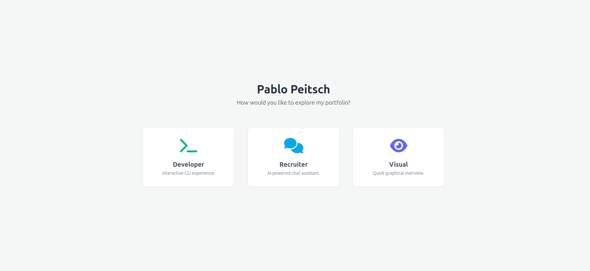
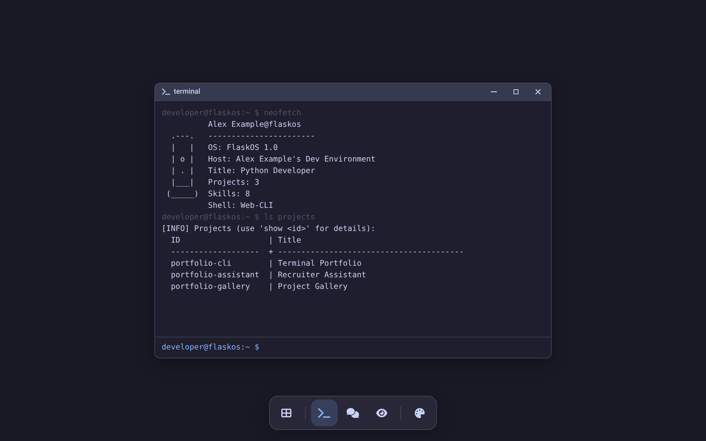
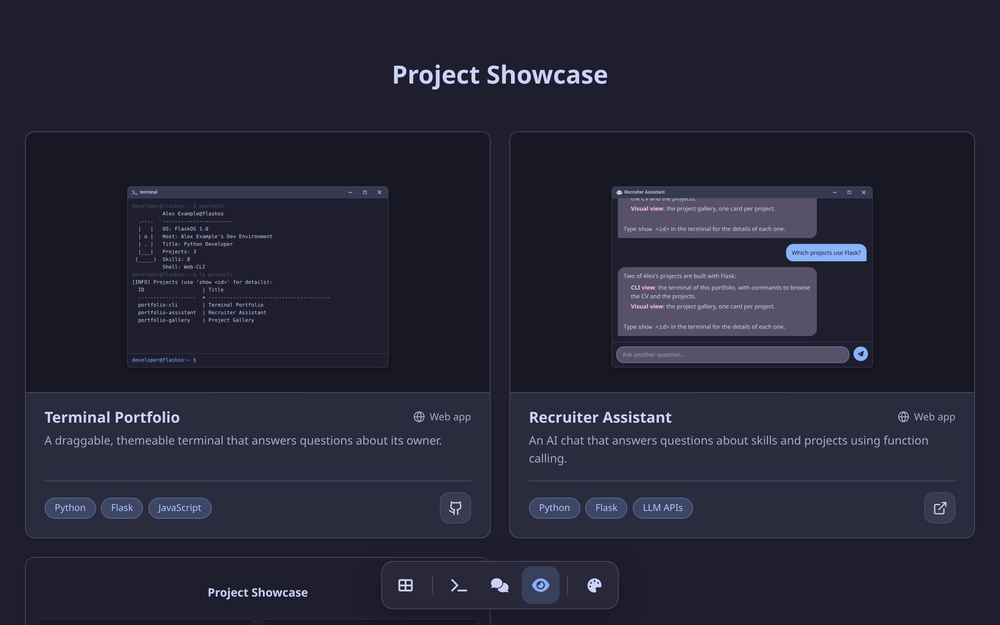

# Unified Portfolio Project 🎭

<!-- Badges -->
[](LICENSE)
[](https://www.python.org)
[](https://flask.palletsprojects.com/)
[](https://github.com/psf/black)
[](https://pycqa.github.io/isort/)
[](https://flake8.pycqa.org/)
[](https://github.com/PPeitsch/porfolio/actions/workflows/code-quality.yml)
[](https://github.com/PPeitsch/porfolio/actions/workflows/tests.yml)
[](https://codecov.io/gh/PPeitsch/porfolio)
[](.github/CONTRIBUTING.md)


A modern, multi-view portfolio website built with Flask, showcasing projects and skills through unique, interactive user experiences.

---

## 📸 Screenshots

<table>
  <tr>
    <td width="50%" align="center">
      <p><strong>1. View Selector</strong></p>
      
    </td>
    <td width="50%" align="center">
      <p><strong>2. Developer (CLI) View</strong></p>
      
    </td>
  </tr>
  <tr>
    <td width="50%" align="center">
      <p><strong>3. Recruiter (AI Chat) View</strong></p>
      
    </td>
    <td width="50%" align="center">
      <p><strong>4. Visual Overview</strong></p>
      
    </td>
  </tr>
</table>


## ✨ Features

*   **👤 Multi-Persona Interface:** Choose how you want to explore the portfolio:
    *   **💻 Developer View:** An interactive, draggable Command-Line Interface that simulates a desktop terminal experience.
    *   **🤖 Recruiter View:** An AI-powered chat assistant (powered by providers like Anthropic Claude) that answers natural language questions about my skills and experience. Access is gated by a simple, secure access code.
    *   **🖼️ Visual View:** A modern, graphical showcase of projects with hover effects and quick-access links.
*   **🧩 Modular & Secure Backend:**
    *   Built with Flask Blueprints for clean separation of concerns.
    *   JWT-based authentication protects the AI Chat API from abuse and data scraping.
    *   Dynamic content (CV, projects) is loaded from simple `.yaml` files, making updates easy and code-free.
*   **🖥️ Reusable UI Components:** Features a shared, draggable window component with standard OS controls (minimize, maximize, close) to ensure a consistent UX across interactive views.
*   **🚀 Modern Stack:** Python 3.12+, Flask, and vanilla JavaScript for a lightweight and fast frontend.
*   **✅ Quality Assured:** Enforces a high standard of code quality through a robust CI/CD pipeline and pre-commit hooks. Includes automated formatting (Black, isort), linting (Flake8), static type checking (MyPy), security scanning (Bandit), and test coverage reporting (Codecov).

## 🚀 Quick Start & Development

1.  **Clone:** `git clone https://github.com/PPeitsch/porfolio.git`
2.  **Navigate:** `cd porfolio`
3.  **Create Environment:** `python -m venv venv && source venv/bin/activate`
4.  **Install Dependencies:** `pip install -r requirements.txt -r requirements-dev.txt`
5.  **Set Up Environment:**
    *   Copy `.env.example` to a new file named `.env`.
    *   Fill in the required values in `.env` (e.g., `ANTHROPIC_API_KEY`, `RECRUITER_ACCESS_CODE`).
6.  **Set Up Pre-Commit Hooks:** `pre-commit install`
7.  **Run:** `python run.py`
8.  Access at `http://127.0.0.1:5000`.

### 📦 Dependency Management

This project uses `pip-tools` for managing Python dependencies to ensure reproducible builds.

-   **Production** dependencies are listed in `requirements.in`.
-   **Development** dependencies are listed in `requirements-dev.in`.

After modifying either of the `.in` files, you must regenerate the locked `requirements.txt` and `requirements-dev.txt` files by running the provided script:
```bash
# For Linux/macOS
./scripts/compile-reqs.sh

# For Windows (PowerShell)
./scripts/compile-reqs.ps1
```
This script will update the `constraints.txt` file and then re-compile both requirement files to ensure they are consistent.

## 🚢 Deployment

This Flask application is ready to be deployed using any production-ready WSGI server like Gunicorn or Waitress behind a reverse proxy like Nginx.

**Example using Gunicorn:**
```bash
# Ensure production environment variables are set
export FLASK_CONFIG=production
export FLASK_DEBUG=0
export SECRET_KEY='your-strong-production-secret-key'
export ANTHROPIC_API_KEY='your-production-anthropic-key'
export RECRUITER_ACCESS_CODE='your-production-access-code'

# Run with Gunicorn
gunicorn --workers 4 --bind 0.0.0.0:8000 run:app
```
**Note:** The application factory pattern (`create_app`) allows for creating different configurations (e.g., `production`, `testing`) in `config.py` if needed.

## 🤝 Contributing

Contributions are highly welcomed! Please see our **[Contributing Guidelines](.github/CONTRIBUTING.md)** before getting started.

## Code of Conduct

We are committed to providing a welcoming environment. Please review our **[Code of Conduct](.github/CODE_OF_CONDUCT.md)**.

## 🛡️ Security

Please refer to the **[Security Policy](.github/SECURITY.md)** for reporting vulnerabilities.

## 📝 License

This project is licensed under the MIT License - see the [LICENSE](LICENSE) file for details.

---

<p align="center">
Built with Flask and a multi-persona approach.
</p>
